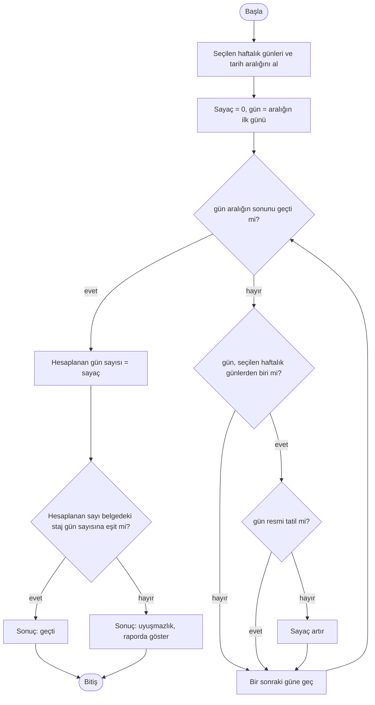

# Staj günü hesabı akışı

> Durum: Staj günü ekranı şu an yalnızca seçimi `InternshipDaySelections` tablosuna kaydeder (`WeekDays`, `RangeStart`, `RangeEnd`). Aşağıdaki hesap ve karşılaştırma (`CalculatedDays`) final aşamasında yazılacak kural için tasarlanmış akıştır.

