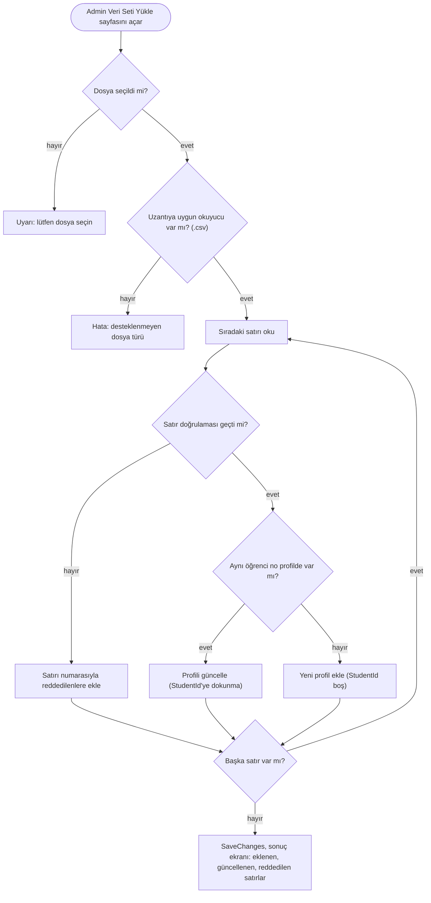

# Veri seti yükleme akışı

Kaynak kod: `DatasetController.Upload`, `DatasetImportService.ImportAsync`, `CsvDatasetReader`

Satır doğrulaması sırasıyla şunları kontrol eder: 12 sütun, öğrenci no, ad soyad ve TC kimlik no boş mu, doğum tarihi `gg.aa.yyyy` mi, önceki staj günü sayı ve 0 veya büyük mü, sağlık yardımı 1-6 mı, dosyada tekrar eden öğrenci no, dosyada tekrar eden e-posta.
