# Class diyagramı: servisler ve controller'lar

Alan modeli ve doğrulama sınıfları için `class-diyagrami.md` dosyasına bakın.

```mermaid
classDiagram
    class ICurrentUserService {
        <<interface>>
        +int? UserId
        +bool IsAdmin
    }
    class ClaimsCurrentUserService
    class FakeCurrentUserService
    ICurrentUserService <|.. ClaimsCurrentUserService
    ICurrentUserService <|.. FakeCurrentUserService

    class IDocumentStatusService {
        <<interface>>
        +CanTransition(from, to) bool
        +Transition(document, to)
        +CanStudentModify(document) bool
    }
    class DocumentStatusService {
        -Dictionary Allowed
    }
    IDocumentStatusService <|.. DocumentStatusService

    class IFileStorage {
        <<interface>>
        +SaveAsync(file) Task~string~
    }
    class FileStorage
    IFileStorage <|.. FileStorage

    class IDocumentService {
        <<interface>>
        +UploadAsync(studentId, file, entered) Task~UploadResult~
        +ReuploadAsync(documentId, studentId, file, entered) Task~UploadResult~
    }
    class DocumentService {
        -RunValidationAsync(document)
        -CheckFile(file) string
    }
    class UploadResult {
        +bool Success
        +string Error
        +int DocumentId
    }
    class EntryChecks {
        <<static>>
        +Validate(data) string
    }
    IDocumentService <|.. DocumentService
    DocumentService --> IFileStorage
    DocumentService --> IDocumentStatusService
    DocumentService --> IValidationService
    DocumentService ..> EntryChecks
    DocumentService ..> UploadResult

    class IAdminDocumentService {
        <<interface>>
        +DeleteAsync(documentId) Task~bool~
        +UpdateAsync(documentId, entered, file) Task~UploadResult~
    }
    class AdminDocumentService
    IAdminDocumentService <|.. AdminDocumentService
    AdminDocumentService --> IFileStorage
    AdminDocumentService ..> EntryChecks

    class IValidationService {
        <<interface>>
        +ValidateAsync(documentId) Task~DocumentStatus~
    }

    class IAuthService {
        <<interface>>
        +LoginAsync(usernameOrEmail, password, ip) Task~LoginResult~
        +RegisterAsync(userName, email, studentNo, password) Task~RegisterResult~
    }
    class AuthService
    class IPasswordHasher {
        <<interface>>
        +Hash(password) string
        +Verify(password, hash) bool
    }
    class BcryptPasswordHasher
    class JwtService {
        +GenerateToken(userId, email, role, fullName) TokenResponseDto
    }
    IAuthService <|.. AuthService
    IPasswordHasher <|.. BcryptPasswordHasher
    AuthService --> IPasswordHasher
    AuthService --> JwtService

    class IDatasetReader {
        <<interface>>
        +Supports(extension) bool
        +Read(stream) IEnumerable~DatasetRow~
    }
    class CsvDatasetReader
    class DatasetImportService {
        +ImportAsync(stream, extension) Task~DatasetImportResult~
    }
    IDatasetReader <|.. CsvDatasetReader
    DatasetImportService o-- IDatasetReader

    class AppDbContext
    DocumentService --> AppDbContext
    AdminDocumentService --> AppDbContext
    AuthService --> AppDbContext
    DatasetImportService --> AppDbContext

    class AuthController {
        +Login()
        +Register()
        +Logout()
        +AccessDenied()
    }
    class StudentController {
        +Index()
    }
    class DocumentsController {
        +Upload()
        +Report()
        +GoogleForm()
        +InternshipDays()
    }
    class AdminController {
        +Index()
        +Documents()
        +Completed()
        +Details()
        +Edit()
        +Delete()
    }
    class DatasetController {
        +Upload()
    }
    class HomeController {
        +Index()
    }
    AuthController --> IAuthService
    DatasetController --> DatasetImportService
    StudentController --> ICurrentUserService
    StudentController --> AppDbContext
    DocumentsController --> IDocumentService
    DocumentsController --> ICurrentUserService
    DocumentsController --> AppDbContext
    AdminController --> IAdminDocumentService
    AdminController --> ICurrentUserService
    AdminController --> AppDbContext
    HomeController --> ICurrentUserService
```

`FakeCurrentUserService` geliştirme sırasında girişten önce kullanılan geçici sınıftır, `Program.cs` içinde `ClaimsCurrentUserService` kayıtlıdır. `DocumentStatusService`, statü geçişlerini ve Tamamlandı kilidini tek yerde toplar (kapsülleme). Servislerin tamamı arayüz üzerinden kullanılır (soyutlama), aynı arayüzün birden çok uygulaması vardır (çok biçimlilik).
