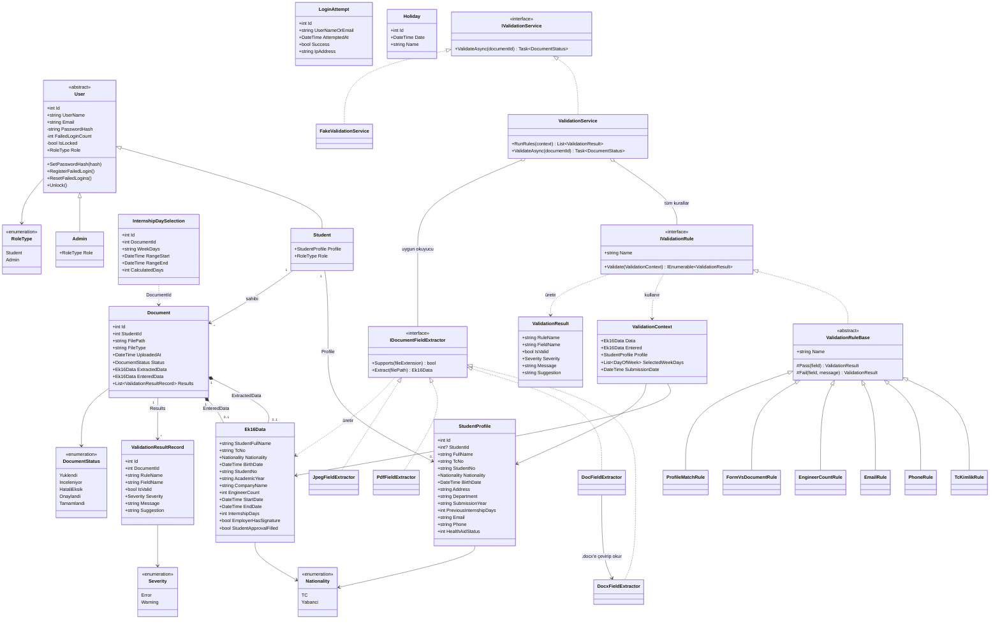

# Class diyagramı: alan modeli ve doğrulama

Servis ve controller sınıfları için `class-diyagrami-servisler.md` dosyasına bakın.

`Ek16Data` toplam 35 alan içerir (öğrenci, staj yapılan yer, işveren, onay bölümleri). Diyagramda temsili alanlar gösterilmiştir, tamamı `Domain/Entities/Ek16Data.cs` dosyasındadır. `DocFieldExtractor`, `.doc` dosyasını LibreOffice ile geçici bir `.docx`'e çevirip `DocxFieldExtractor`'a devreder. `JpegFieldExtractor` şimdilik iskelettir: OCR yazılmadı, boş `Ek16Data` döndürür. `FakeValidationService` geliştirme için yazılmış geçici sınıftır, `Program.cs` içinde kayıtlı değildir.