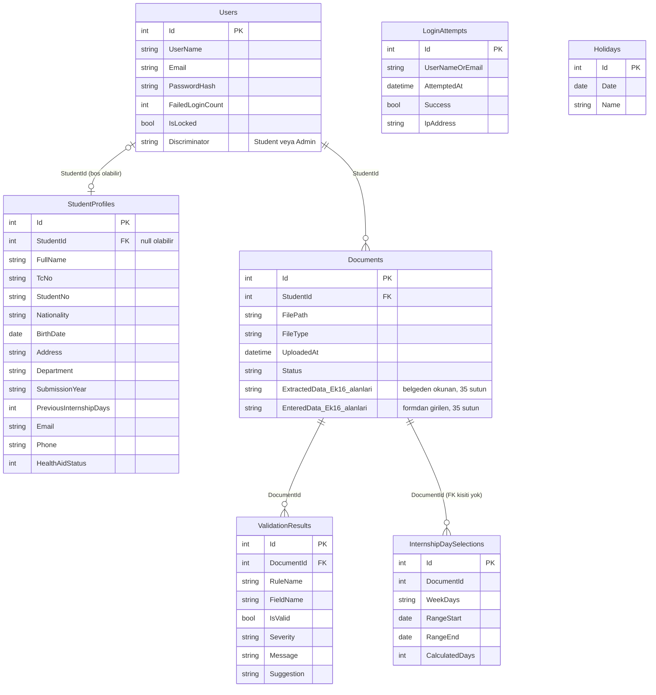

# Veri Tabanı (ER) Diyagramı

Tablolar `AppDbContext` ve migration dosyalarından çıkarılmıştır. `Student` ve `Admin` aynı `Users` tablosunda tutulur (TPH, `Discriminator` sütunu). `Ek16Data` ayrı tablo değildir: `Documents` tablosuna `ExtractedData_` ve `EnteredData_` önekli sütunlar olarak gömülüdür.

`LoginAttempts` ve `Holidays` diğer tablolara bağlı değildir. `Holidays` tablosunu staj günü kuralı (final) dolduracaktır. EF Core'un kendi tablosu `__EFMigrationsHistory` diyagrama alınmamıştır.
